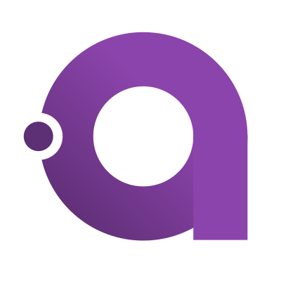
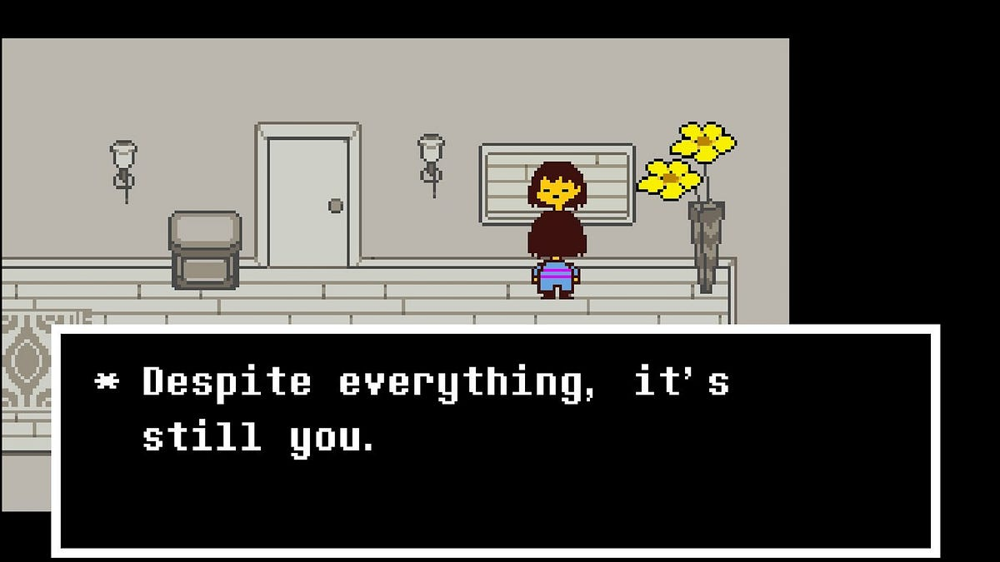

<h1>Hi, I'm Halil KAYA</h1>
<picture>
  <source media="(prefers-color-scheme: dark)"
          srcset="https://raw.githubusercontent.com/halilksya/halilksya/snake/snake-dark.svg" />
  
</picture>

  Hi, I'm Halil — a third-year software engineering student. 
  I enjoy building things in C and C#, anything from desktop applications
  to code that runs close to the hardware. 
  Outside of that I keep picking up new languages and exploring fields
  I haven't worked in yet.

 

<h3 align="center">Contact:</h3>

  &nbsp;&nbsp;&nbsp;
  &nbsp;&nbsp;&nbsp;
  &nbsp;&nbsp;&nbsp;
  

<h3 align="center">Languages And Tools</h3>

  &nbsp;&nbsp;
  &nbsp;&nbsp;
  &nbsp;&nbsp;
  &nbsp;&nbsp;
  &nbsp;&nbsp;
  &nbsp;&nbsp;
  &nbsp;&nbsp;
  &nbsp;&nbsp;
  &nbsp;&nbsp;
  &nbsp;&nbsp;
  
    &nbsp;&nbsp;
  

  
  

  

  

  • I love the C family btw &lt;3

